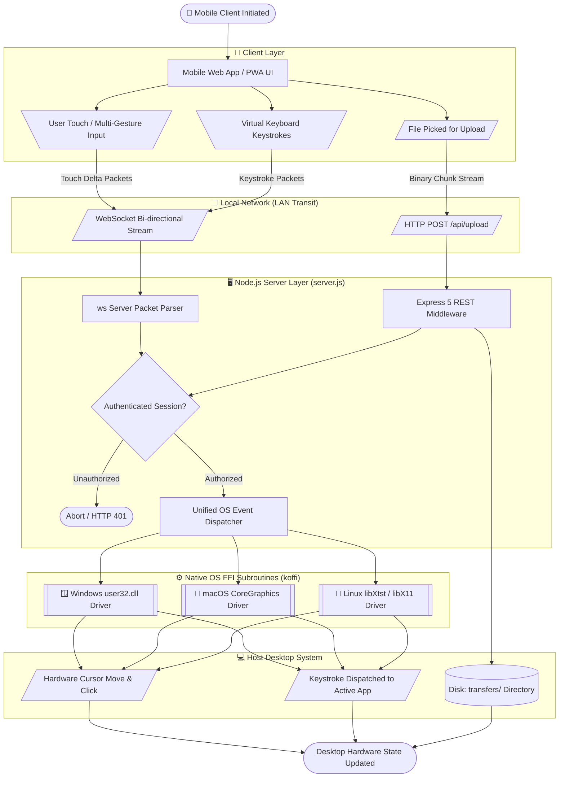
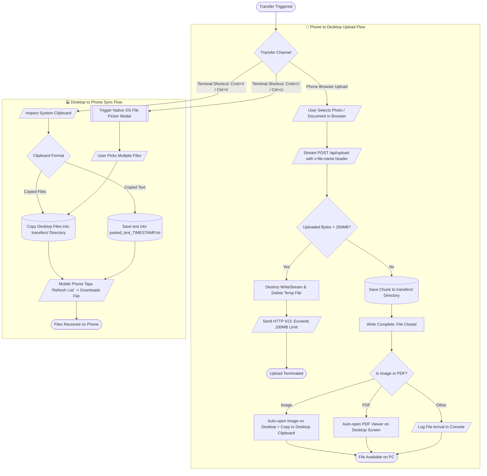

# 📐 `mouse-vm` Standard Flowcharts & Architecture Documentation

This document contains standardized flowchart diagrams for **`mouse-vm`** adhering strictly to **ISO 5807 standard flowchart symbols**.

---

## 🏷️ Standard Flowchart Symbol Legend

| Symbol Shape | Mermaid Syntax | Standard Meaning (ISO 5807) | Usage in this System |
| :---: | :---: | :--- | :--- |
| **Stadium / Oval** | `([Text])` | **Terminal (Start / End)** | Entry point, exit, success/abort termination |
| **Rectangle** | `[Text]` | **Process / Operation** | Internal computation, variable manipulation, execution |
| **Diamond** | `{Text?}` | **Decision / Branching** | Conditional checks (authentication, OS type, errors) |
| **Parallelogram** | `[/Text/]` | **Input / Output (I/O)** | Network packets, user touch inputs, API payloads |
| **Subroutine** | `[[Text]]` | **Predefined Subroutine / Driver** | Native OS C FFI drivers (`koffi`, `user32`, `CoreGraphics`) |
| **Cylinder** | `[(Text)]` | **Data Store / Storage** | Disk directories (`transfers/`), in-memory security maps |
| **Hexagon** | `{{Text}}` | **Preparation / Initialization** | Hardware initialization, FFI library loading |

---

## 📑 Table of Contents
1. [End-to-End System Architecture Flowchart](#1-end-to-end-system-architecture)
2. [Connection & QR Code Pairing Handshake Flowchart](#2-connection--qr-code-pairing-handshake)
3. [Real-Time Input Event Pipeline Flowchart](#3-real-time-input-event-pipeline)
4. [Cross-Platform Native OS Dispatcher Flowchart](#4-cross-platform-native-os-dispatcher)
5. [macOS AirPlay & Port Conflict Self-Healing Flowchart](#5-port-conflict-auto-recovery-flowchart)
6. [Bidirectional File Transfer & Clipboard Sync Flowchart](#6-bidirectional-file-transfer--clipboard-sync)
7. [Multi-Layer Security & Brute-Force Defense Flowchart](#7-multi-layer-security--brute-force-defense)

---

## 1. End-to-End System Architecture



---

## 2. Connection & QR Code Pairing Handshake

```mermaid
flowchart TD
    Start([Launch Server: node server.js]) --> GenPIN[Generate Random 4-Digit PIN]
    GenPIN --> DetectIP[Detect Local Wi-Fi IPv4 Address]
    DetectIP --> FormURL[Format URL: http://IP:PORT/?code=PIN]
    FormURL --> DrawQR[/Render ASCII QR Code to Host Terminal/]

    DrawQR --> UserScan[\User Scans QR Code with Phone Camera/]
    UserScan --> ClientOpen[Browser Opens Client PWA Application]
    ClientOpen --> WSOpen[/Establish WebSocket Handshake: ws://IP:PORT/]

    WSOpen --> SendAuth[/Client Sends: {type: 'auth', code: PIN}/]
    SendAuth --> CheckLockout{Is IP Address Locked Out?}

    CheckLockout -->|Yes >= 5 fails| LockoutResp[/Close Socket: code 4001 / Too Many Attempts/]
    LockoutResp --> FailEnd([Connection Rejected])

    CheckLockout -->|No| VerifyPIN{Submitted PIN == Server PIN?}
    
    VerifyPIN -->|No| RecordFail[Increment Failure Count in IP Lockout Map]
    RecordFail --> SendAuthErr[/Send: {type: 'auth_result', status: 'error'}/]
    SendAuthErr --> RetryEnd([Prompt User to Re-enter PIN])

    VerifyPIN -->|Yes| SetAuth[Set authenticated = true on Socket]
    SetAuth --> SendAuthOK[/Send: {type: 'auth_result', status: 'success'}/]
    SendAuthOK --> Haptic[Client Triggers Success Vibration]
    Haptic --> ReadyEnd([Device Paired: Switch to Trackpad Screen])
```

---

## 3. Real-Time Input Event Pipeline

```mermaid
flowchart TD
    StartInput([User Touches Trackpad Screen]) --> Capture[\Capture PointerEvents: pointerdown / pointermove / pointerup/]
    
    Capture --> EventKind{Input Event Kind}

    EventKind -->|Single Finger Move| DeltaCalc[Calculate Delta dx, dy with DPI Acceleration]
    DeltaCalc --> PackMove[/Serialize JSON: {type: 'move', dx: 14, dy: -6}/]

    EventKind -->|Finger Tap| PackClick[/Serialize JSON: {type: 'click', button: 'left', action: 'click'}/]

    EventKind -->|Two-Finger Drag| PackScroll[/Serialize JSON: {type: 'scroll', dy: 3}/]

    EventKind -->|Keyboard Keystroke| PackKey[/Serialize JSON: {type: 'text', text: 'A'} or {type: 'key', key: 'enter'}/]

    PackMove --> SendWS[/Send Packet over WebSocket Binary Frame/]
    PackClick --> SendWS
    PackScroll --> SendWS
    PackKey --> SendWS

    SendWS --> ServerRecv[/Server ws on 'message' Triggered/]
    ServerRecv --> ParseJSON[JSON.parse Buffer]
    
    ParseJSON --> CheckAuth{Is Socket Authenticated?}
    CheckAuth -->|No| DropPacket[Drop Packet & Close Socket]
    DropPacket --> EndDrop([Drop Unauthorized Packet])

    CheckAuth -->|Yes| DispatchType{Message Type}

    DispatchType -->|'move'| CallMove[[Subroutine: moveMouseRelative dx, dy]]
    DispatchType -->|'click'| CallClick[[Subroutine: mouseClick btn, action]]
    DispatchType -->|'scroll'| CallScroll[[Subroutine: mouseScroll dy]]
    DispatchType -->|'text'| CallText[[Subroutine: typeText text]]
    DispatchType -->|'key'| CallKey[[Subroutine: pressSpecialKey key]]

    CallMove --> ExecuteOS[Invoke Native OS Kernel / Display Server C API]
    CallClick --> ExecuteOS
    CallScroll --> ExecuteOS
    CallText --> ExecuteOS
    CallKey --> ExecuteOS

    ExecuteOS --> Finish([Hardware State Updated in <1 Millisecond])
```

---

## 4. Cross-Platform Native OS Dispatcher

```mermaid
flowchart TD
    ActionIn[/Input Action Dispatched/] --> DetectPlatform{Evaluate process.platform}

    subgraph WindowsFlow ["🪟 Windows (win32) Pipeline"]
        DetectPlatform -->|win32| WinPrep{{Load user32.dll via koffi}}
        WinPrep --> WinCheck{Action Subroutine}
        WinCheck -->|Move| W1["user32.mouse_event(MOUSEEVENTF_MOVE, dx, dy)"]
        WinCheck -->|Click| W2["user32.mouse_event(MOUSEEVENTF_LEFTDOWN / UP)"]
        WinCheck -->|Scroll| W3["user32.mouse_event(MOUSEEVENTF_WHEEL, dy)"]
        WinCheck -->|Keystroke| W4["user32.keybd_event(VK_CODE)"]
        WinCheck -->|Unicode Text| W5["user32.keybd_event(KEYEVENTF_UNICODE)"]
        WinCheck -->|App Switch| W6["Hold VK_MENU + Tap VK_TAB"]
    end

    subgraph MacFlow ["🍏 macOS (darwin) Pipeline"]
        DetectPlatform -->|darwin| MacPrep{{Load CoreGraphics.framework via koffi}}
        MacPrep --> MacCheck{Action Subroutine}
        MacCheck -->|Move| M1["CoreGraphics.CGWarpMouseCursorPosition(newLoc)<br/>+ CGEventCreateMouseEvent(MouseMoved / Dragged)"]
        MacCheck -->|Click| M2["CoreGraphics.CGEventCreateMouseEvent(LeftMouseDown/Up)<br/>+ CGEventPost(kCGHIDEventTap)"]
        MacCheck -->|Scroll| M3["CoreGraphics.CGEventCreateScrollWheelEvent()"]
        MacCheck -->|Keystroke| M4["CoreGraphics.CGEventCreateKeyboardEvent()<br/>+ CGEventSetFlags(Command / Shift / Option)"]
        MacCheck -->|Unicode Text| M5["CoreGraphics.CGEventKeyboardSetUnicodeString(u16)"]
        MacCheck -->|App Switch| M6["Hold Command (0x37) + Tap Tab (0x30)"]
    end

    subgraph LinuxFlow ["🐧 Linux (linux) Pipeline"]
        DetectPlatform -->|linux| LinPrep{{Check libXtst FFI vs xdotool CLI}}
        LinPrep --> LinCheck{Backend Available?}
        LinCheck -->|libXtst / libX11| L1["libX11.XWarpPointer() + libXtst.XTestFakeButtonEvent()<br/>+ libXtst.XTestFakeKeyEvent()"]
        LinCheck -->|xdotool / ydotool| L2["child_process.execFile('xdotool', ['mousemove_relative', ...])<br/>OR 'ydotool' on Wayland"]
    end

    W1 --> Complete([Hardware Output Rendered])
    W2 --> Complete
    W3 --> Complete
    W4 --> Complete
    W5 --> Complete
    W6 --> Complete

    M1 --> Complete
    M2 --> Complete
    M3 --> Complete
    M4 --> Complete
    M5 --> Complete
    M6 --> Complete

    L1 --> Complete
    L2 --> Complete
```



---

## 5. Port Conflict Auto-Recovery Flowchart

```mermaid
flowchart TD
    Start([Execute Server Startup]) --> DetectOS{Is OS == darwin (macOS)?}
    
    DetectOS -->|Yes| SetMacPort[Default to Port 5050<br/>Prevents macOS ControlCenter AirPlay Conflict]
    DetectOS -->|No| SetStandardPort[Default to Standard Port 5000]

    SetMacPort --> BindAttempt[Execute: httpServer.listen port]
    SetStandardPort --> BindAttempt

    BindAttempt --> ResultCheck{Listen Status}

    ResultCheck -->|Listening (Code 0)| DisplaySuccess[/Print Active Server Banner & ASCII QR Code/]
    DisplaySuccess --> ServerOnline([Server Online & Ready for Connections])

    ResultCheck -->|Error: EADDRINUSE| CustomCheck{Did User Pass Custom --port?}

    CustomCheck -->|Yes| PrintErr[/Print: Port in use by PID. Exiting./]
    PrintErr --> AbortFail([Exit Process with Code 1])

    CustomCheck -->|No| StepUp[Increment Port: Port = Port + 10 e.g. 5050 -> 5060]
    StepUp --> CloseServer[Execute: httpServer.close()]
    CloseServer --> Delay[Wait 200ms Clean Rebind Delay]
    Delay --> BindAttempt
```

---

## 6. Bidirectional File Transfer & Clipboard Sync



---

## 7. Multi-Layer Security & Brute-Force Defense

```mermaid
flowchart TD
    ReqIn[/Incoming Request from Client/] --> RouteSplit{Request Transport Type}

    subgraph HTTP_Guard ["Layer 1: HTTP REST Rate Limiter"]
        RouteSplit -->|HTTP: /api/*| LimiterCheck{express-rate-limit Window: 60s}
        LimiterCheck -->|Requests > 10 / min| BlockHTTP[/Reject with HTTP 429: Too Many Attempts/]
        BlockHTTP --> SecFail([Access Blocked])

        LimiterCheck -->|Within Threshold| CheckPINHeader{Header 'x-pin' == SERVER_PIN?}
        CheckPINHeader -->|No| RejectHTTP[/Reject with HTTP 401: Unauthorized/]
        RejectHTTP --> SecFail

        CheckPINHeader -->|Yes| PathGuard{Is File Route: /api/upload?}
        PathGuard -->|Yes| Sanitize[Execute sanitizeFilename Function]
        Sanitize --> StripPath[Strip ../, Absolute Paths & Null Bytes]
        StripPath --> ConfinDisk[(Confine File Strictly Inside transfers/)]
        ConfinDisk --> SecPass([API Access Approved])
        PathGuard -->|No| SecPass
    end

    subgraph WS_Guard ["Layer 2: WebSocket Brute-Force Lockout"]
        RouteSplit -->|WebSocket Stream| CheckMap{Remote IP in wsAuthAttempts Map?}
        CheckMap -->|Attempts >= 5 in 60s| CloseSocket[/Force-Close WebSocket: Code 4001/]
        CloseSocket --> SecFail

        CheckMap -->|Attempts < 5| EvaluateWSPIN{Data 'code' == SERVER_PIN?}
        EvaluateWSPIN -->|No| RecordAttempt[Increment Failed Attempt Counter for Remote IP]
        RecordAttempt --> SendWSErr[/Send: {type: 'auth_result', status: 'error'}/]
        SendWSErr --> SecFail

        EvaluateWSPIN -->|Yes| GrantWS[Clear Failure Counter & Mark authenticated = true]
        GrantWS --> SecPass
    end
```
