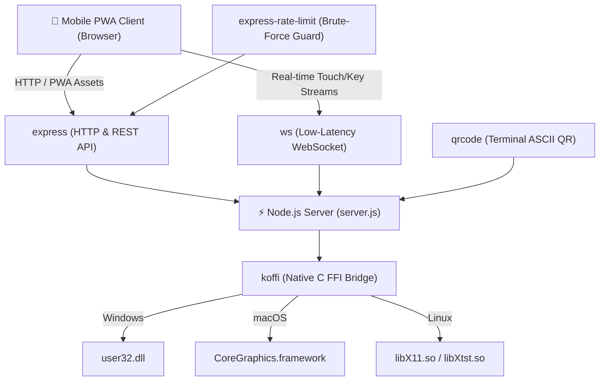
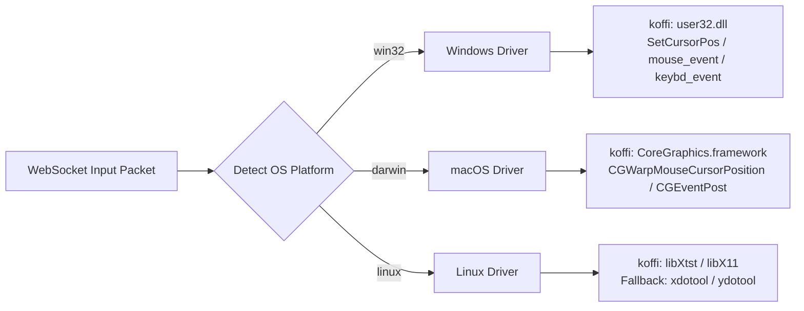
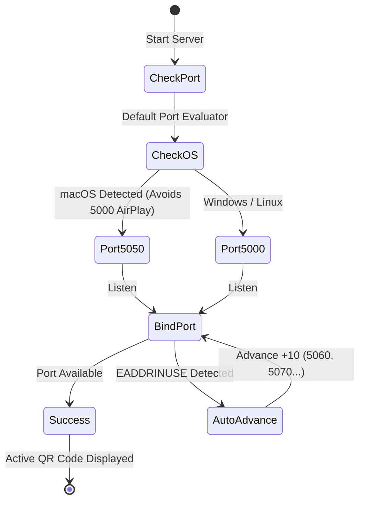

# 📊 Comprehensive Package & Project Presentation Report
## `mouse-vm` (Virtual Mouse & Keyboard Remote Controller)

---

## 🎯 1. Executive Summary

| Attribute | Specification |
| :--- | :--- |
| **Package Name** | `mouse-vm` (aliases: `vm2do`, `vm`, `virtual-mouse`) |
| **Version** | `v1.0.15` |
| **Workspace Root** | `mouse-sim-workspace` |
| **Target Platforms** | 🪟 Windows (10/11) · 🍏 macOS (Sonoma/Sequoia/Ventura) · 🐧 Linux (X11 & Wayland) |
| **Client Support** | iOS Safari, Android Chrome, Tablet & Desktop Browsers (Installable PWA) |
| **Runtime Requirement** | Node.js `>=20.0.0 \|\| >=22.0.0 \|\| >=24.0.0` |
| **Architecture** | Low-latency WebSocket duplex communication + REST File APIs + Native OS FFI |

---

## 📦 2. Package Dependency Breakdown

`mouse-vm` was engineered for maximum performance with **zero bloated native build toolchains** (no Python or C++ compiler required on user machines during install):

### Detailed Dependency Table

| Package | Version | Purpose in Project | Key Value / Why Selected |
| :--- | :---: | :--- | :--- |
| **`express`** | `^5.1.0` | Serves client PWA web assets and handles file transfer REST endpoints (`/api/upload`, `/api/files`). | Express 5 offers native async error handling and ultra-lightweight memory footprint. |
| **`ws`** | `^8.21.3` | Powers ultra-low-latency bidirectional touch event streaming (move, click, scroll, keystroke). | Industry-standard WebSocket library with 64KB bounded payload security and sub-millisecond dispatch. |
| **`koffi`** | `^3.2.1` | Ultra-fast native Foreign Function Interface (FFI) to call OS C APIs directly from JavaScript. | Up to **10x faster** than legacy `ffi-napi`, precompiled for x64/arm64, eliminating `node-gyp` compile errors. |
| **`qrcode`** | `^1.5.4` | Generates high-contrast ASCII QR codes directly in the terminal on server startup. | Instant camera pairing without typing long IP addresses or connection URLs. |
| **`express-rate-limit`** | `^8.7.0` | IP-based request throttler protecting PIN authentication routes. | Prevents automated brute-force attacks against connection PINs (10 attempts/min window). |

---

## 🖥️ 3. Cross-Platform Engine Architecture

### 1. Windows Architecture (`win32`)
- **Engine**: Dynamic binding to `user32.dll` via `koffi`.
- **DPI Awareness**: Calls `SetProcessDPIAware()` on startup for true 1:1 hardware pixel scaling on high-resolution displays.
- **Shortcuts & Shell**: Native Windows virtual keys (`VK_LWIN`, `VK_MENU`, `VK_CONTROL`), PowerShell file drop extraction, and Explorer launcher.

### 2. macOS Architecture (`darwin`)
- **Engine**: Dynamic binding to `/System/Library/Frameworks/CoreGraphics.framework/CoreGraphics`.
- **Zero-Latency Pointer**: Calls `CGWarpMouseCursorPosition` for instant cursor teleportation that functions even without accessibility configuration.
- **Click & Drag**: `CGEventCreateMouseEvent` with automatic dragging state tracking (`kCGEventLeftMouseDragged`).
- **Unicode Typing**: `CGEventKeyboardSetUnicodeString` delivers full international character support.
- **macOS Native Shortcuts**: Automatic modifier remapping (`Ctrl+C` $\rightarrow$ `Cmd+C`, `Ctrl+V` $\rightarrow$ `Cmd+V`, `Alt+Tab` $\rightarrow$ `Cmd+Tab` application switcher).
- **System Integrations**: Cocoa `NSPasteboard` integration via AppleScript for seamless image and file paste.

### 3. Linux Architecture (`linux`)
- **Engine**: Dual-mode engine supporting dynamic `libX11.so.6` & `libXtst.so.6` C FFI for pure X11 speed.
- **Wayland / Headless Fallback**: Transparently falls back to `xdotool` or `ydotool` (Wayland).
- **Desktop Interoperability**: `xdg-open` for opening directories, `zenity`/`kdialog` for GUI file selection, `wl-paste`/`xclip` for clipboard sync.

---

## ⚡ 4. AirPlay Defense & Port Fault-Tolerance

A unique challenge resolved on modern macOS (Monterey, Ventura, Sonoma, Sequoia) is that **Apple AirPlay Receiver (`ControlCenter`) listens permanently on port 5000**:

---

## 🛡️ 5. Security & Privacy Model

1. **Local Network Isolation**: No cloud relay or external server reliance; zero telemetry.
2. **Session PIN Verification**: All API endpoints and WebSockets mandate a randomized 4-digit PIN exchange.
3. **Double Brute-Force Barrier**:
   - HTTP: `express-rate-limit` enforces 10 attempts/minute window.
   - WebSocket: In-memory IP tracking terminates connection after 5 bad attempts for 60 seconds.
4. **Path Traversal Shield**: `sanitizeFilename()` strips path traversal sequences (`../`, null bytes, system paths) ensuring uploads remain strictly inside `transfers/`.
5. **Payload Limiter**: Streaming chunk parser caps file uploads at 200MB and rejects oversized uploads with `HTTP 413` before memory exhaustion.

---

## 📽️ 6. Slide-by-Slide Presentation Outline

If you are creating presentation slides (PowerPoint / Keynote / Google Slides), use this structure:

### Slide 1: Title & Hook
- **Title**: `mouse-vm` — Universal Wireless Trackpad & Desktop Controller
- **Subtitle**: Transforming any mobile device into a zero-latency computer peripheral over Wi-Fi.
- **Presenter**: *[Your Name / Team]*

### Slide 2: Problem Statement
- Traditional wireless mice require Bluetooth dongles or proprietary drivers.
- In emergencies (broken trackpad, presenting across a conference room, lost mouse), users have no input control.
- Cross-platform solutions are either commercial paywalled apps or require heavy desktop installations.

### Slide 3: The Solution
- Zero client installation: Pure Progressive Web App (PWA) accessed via QR code scan.
- Completely cross-platform: Windows, macOS, and Linux supported out-of-the-box.
- Multi-functional: Trackpad + Live Auto-Typing + File Transfer + Clipboard Sync in one screen.

### Slide 4: System Architecture
- Lightweight Node.js server with dual HTTP/WebSocket protocol.
- Direct C FFI bindings via `koffi` (Windows `user32.dll`, macOS `CoreGraphics`, Linux `XTest`).
- Why FFI? Sub-millisecond latency without compile-time C++ dependencies.

### Slide 5: Core Features & Live Demo
- **Trackpad**: 1:1 responsive movement, multi-touch scroll, click-and-drag.
- **Live Keyboard**: Real-time auto-typing, quick shortcut modifiers (`Cmd/Ctrl+C`, `Cmd/Ctrl+V`, `Alt/Cmd+Tab`).
- **File Transfer**: Drag-and-drop 200MB file transfer + instant desktop clipboard sync.

### Slide 6: Engineering Challenges Solved
- Port 5000 AirPlay collision on macOS $\rightarrow$ Smart fallback system.
- Cross-platform keyboard mapping differences (Mac `Command` vs Windows `Ctrl`).
- Security architecture (Rate limiting, PIN verification, path sanitization).

### Slide 7: Tech Stack & Dependencies
- `express` · `ws` · `koffi` · `qrcode` · `express-rate-limit`
- Standards: HTML5 Pointer Events, WebSockets, Web App Manifest, Service Workers.

### Slide 8: Q&A / Thank You
- Links to GitHub repo and NPM package (`mouse-vm`).
